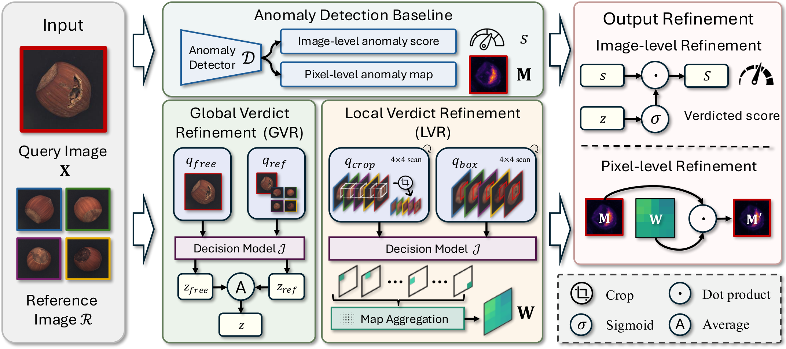

<div align="center">

# VerdictAD: Few-Shot Anomaly Detection via Decision-Guided Refinement

Shangquan Sun<sup>1</sup>, Wenjun Luo<sup>1</sup>, Yuanzhi Wang<sup>1</sup>, Ruiqi Li<sup>1</sup>, Ruoyu Chen<sup>2</sup>, Jiachen Liu<sup>3</sup>, Shijian Lu<sup>1</sup>

<sup>1</sup>Nanyang Technological University &nbsp; <sup>2</sup>Michigan State University &nbsp; <sup>3</sup>University of Michigan

[](VerdictAD.pdf)
[](requirements.txt)
[](requirements.txt)
[](LICENSE)

</div>

<p align="center"></p>

<details>
<summary><b>Abstract</b> (click to expand)</summary>

Detecting defects in real-world industrial inspection often requires learning from only a few normal images per category. Recent few-shot anomaly detection methods have achieved strong performance by measuring feature differences between query images and normal references. However, visual differences do not always indicate genuine defects, as normal appearance variations can also produce high anomaly scores. Conversely, structural or logical anomalies may not produce strong local feature differences, making them difficult to detect. To address this limitation, we introduce VerdictAD, a training-free framework that refines existing anomaly detectors through visual decisions. VerdictAD adopts a typed decision model to assess the query image and its local regions against a few normal references. By directly producing structured decision probabilities without text generation, the model provides complementary evidence for refining anomaly responses at different spatial scales. Building on this capability, we introduce two modules: Global Verdict Refinement (GVR) uses image-level decisions to refine the overall anomaly score, while Local Verdict Refinement (LVR) aggregates regional decisions to refine the anomaly map. Combined with a simple DINOv2-based detector, VerdictAD achieves competitive performance in one-shot and few-shot anomaly detection. As a plug-and-play framework, it consistently improves existing anomaly detectors across MVTec AD, VisA, and MVTec LOCO AD in one-shot and few-shot settings.

</details>

## 🚀 News

- **2026.11** Code and experiment logs released.

## 📊 Results

4-shot, mean over three reference draws (seeds 42, 43, 45). Each cell: Image AUROC / Pixel AUROC / AUPRO (%). The detector and VerdictAD use the same references.

| Detector | MVTec AD | VisA | MVTec LOCO AD |
|---|:-:|:-:|:-:|
| PatchCore | 93.0 / 96.4 / 91.2 | 89.0 / 97.5 / 89.4 | 67.4 / 74.9 / 66.7 |
| **+ VerdictAD** | **97.5 / 96.5 / 92.0** | **93.9 / 98.0** / 88.5 | **78.0 / 79.9 / 68.7** |
| DINOv2-L | 97.2 / 97.4 / 95.2 | 93.6 / 98.3 / 93.8 | 68.7 / 77.1 / 62.8 |
| **+ VerdictAD** | **98.7 / 97.9 / 95.7** | **96.9 / 98.7 / 94.4** | **77.5 / 80.0 / 65.4** |
| AnomalyDINO | 98.0 / 97.4 / 93.7 | 93.6 / 98.2 / 94.6 | 67.4 / 81.5 / 59.5 |
| **+ VerdictAD** | **98.9 / 97.7 / 94.2** | **96.3 / 98.3 / 95.2** | **74.9 / 82.7 / 61.1** |
| SubspaceAD | 98.1 / 98.0 / 95.2 | 94.6 / 98.4 / 95.9 | 67.5 / 76.6 / 69.5 |
| **+ VerdictAD** | **98.8 / 98.1 / 95.6** | **96.5 / 98.8 / 96.3** | **75.3 / 79.3 / 71.3** |

The 1-shot and 2-shot tables, Image AUPR, and every per-seed, per-class result are in [`logs/`](logs). `python tools/summarize_logs.py` rebuilds all tables from them.

## ⚙️ Installation

```bash
git clone https://github.com/sgstq0811/VerdictAD-Jev-AD.git && cd VerdictAD-Jev-AD
pip install -r requirements.txt
git clone https://github.com/CLendering/SubspaceAD.git && (cd SubspaceAD && git apply ../patches/subspacead.patch)
```

The patch makes SubspaceAD save its anomaly maps, image scores and sampled references. The decision model [Clef-Flash 9B](https://huggingface.co/Cloudflare/clef-flash) is downloaded from Hugging Face on first use.

## 🧩 Datasets

| Dataset | Source | Layout |
|---|---|---|
| MVTec AD | [mvtec.com](https://www.mvtec.com/company/research/datasets/mvtec-ad) | as released |
| VisA | [spot-diff](https://github.com/amazon-science/spot-diff) | 1-class split (`split_csv/1cls.csv`) |
| MVTec LOCO AD | [mvtec.com](https://www.mvtec.com/company/research/datasets/mvtec-loco) | `python tools/prepare_loco.py <loco_root> data/loco` |

## 🛠️ Usage

**1. Base detector.** SubspaceAD, 4-shot, seed 42 (`--dataset_name visa` for VisA; `mvtec_ad` with `data/loco` for LOCO):

```bash
cd SubspaceAD && SUB_NO_ATTN=1 python main.py --dataset_name mvtec_ad --dataset_path ../data/mvtec_anomaly_detection \
  --k_shot 4 --seed 42 --image_res 672 --layers=-12,-13,-14,-15,-16,-17,-18 --model_ckpt facebook/dinov2-with-registers-giant \
  --aug_count 30 --pca_ev 0.99 --agg_method mean --outdir ../runs/sub_mvtec_k4_s42 && cd ..
RUN=$(ls -d runs/sub_mvtec_k4_s42/*/)
```

PatchCore (`pc`) and DINOv2-L (`dino`) take the same references:

```bash
python detectors.py dino $RUN $RUN runs/dino_mvtec_k4_s42 --shots 4 --data_root data/mvtec_anomaly_detection
```

**2. Decisions.** GVR and LVR decisions for every test image (`--batch 4` fits a 24 GB GPU):

```bash
python decide.py $RUN runs/jev_mvtec_k4_s42 --data_root data/mvtec_anomaly_detection
```

**3. Evaluation.** Detector alone and with VerdictAD (α = 0.5, γ = 0.25; AUPRO uses SubspaceAD's official function):

```bash
python evaluate.py $RUN runs/jev_mvtec_k4_s42 --subspacead SubspaceAD
python evaluate.py runs/dino_mvtec_k4_s42 runs/jev_mvtec_k4_s42 --subspacead SubspaceAD
```

The decisions depend only on the query and its references, so one `decide.py` output serves every detector that uses those references. `--alpha`, `--gamma` and `--windows crop|box|merged` reproduce the ablations.

**AnomalyDINO** is scored with its own metric code. Apply `patches/anomalydino.patch` to [AnomalyDINO](https://github.com/dammsi/AnomalyDINO), then run:

```bash
bash anomalydino/run.sh /path/to/AnomalyDINO MVTec data/mvtec_anomaly_detection 4 42 $RUN runs/jev_mvtec_k4_s42
```

## 📣 Citation

```bibtex
@article{sun2026verdictad,
  title   = {VerdictAD: Few-Shot Anomaly Detection via Decision-Guided Refinement},
  author  = {Sun, Shangquan and Luo, Wenjun and Wang, Yuanzhi and Li, Ruiqi and Chen, Ruoyu and Liu, Jiachen and Lu, Shijian},
  journal = {arXiv preprint},
  year    = {2026}
}
```

## Acknowledgement

This code builds on [SubspaceAD](https://github.com/CLendering/SubspaceAD), [AnomalyDINO](https://github.com/dammsi/AnomalyDINO), [DINOv2](https://github.com/facebookresearch/dinov2) and [Clef-Flash](https://huggingface.co/Cloudflare/clef-flash).

## 📬 Contact

Please open an issue, or email Shangquan Sun ([shangquansun@gmail.com](mailto:shangquansun@gmail.com)).

## License

Code is released under [Apache 2.0](LICENSE). Datasets and model weights keep their own licenses.
